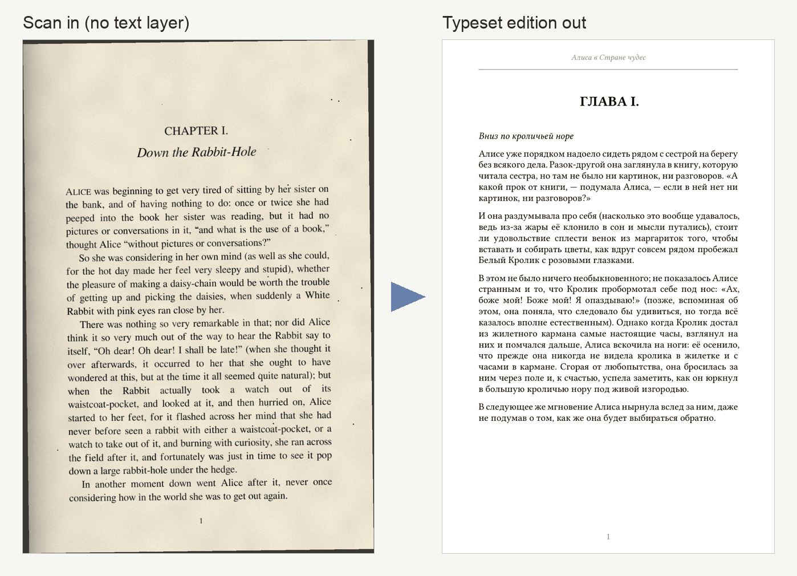
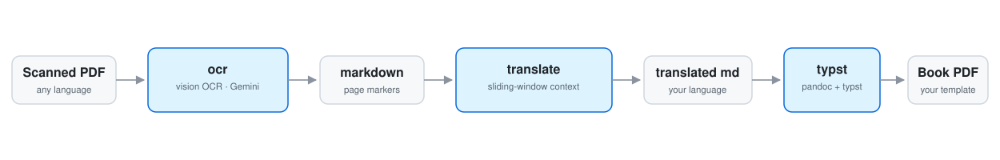
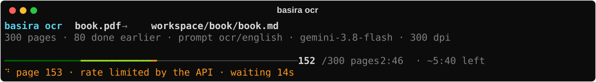

<h3 align="center">
  <br>
  Scanned book in, a new edition in your language out
</h3>

<p align="center">
  <a href="https://github.com/gushmazuko/basira-vision/actions/workflows/ci.yml"></a>
  
  <a href="LICENSE"></a>
</p>

Basira Vision is a command-line tool that turns a scanned book into a typeset
PDF in another language. A vision model reads every page image, the text is
translated page by page with the previous page as context, and Pandoc + Typst
lay it out as a book. Between the steps you get plain markdown files to
review and fix.

<p align="center">
  
</p>

## How it works

<p align="center">
  
</p>

1. **`basira ocr`** renders each page to an image and has a vision model
   read it. This works where classic OCR struggles: no text layer, skewed or
   noisy scans, complex scripts, diacritics, less common languages.
   Per-language prompts handle details such as reading direction or letters
   models tend to confuse.
2. **`basira translate`** translates one page at a time and sends the
   finished translation of the previous page along as context. This
   one-page **sliding window** keeps names, terms and voice consistent
   across the book. A failed page clears the window, so one bad page never
   affects the next.
3. **`basira typst`** typesets the result as an A5 book: title page,
   optional translator's preface, table of contents, running heads,
   footnotes, and an even page count for printing. Everything comes from
   one editable Typst template.

Every stage saves after each page and can resume where it stopped.

## Install

You need Python 3.10+, [Pandoc](https://pandoc.org/installing.html) and
[Typst](https://github.com/typst/typst#installation) (Pandoc and Typst are
only used by the `typst` step).

```bash
# macOS
brew install pandoc typst
# Debian/Ubuntu (Typst from its releases page or `cargo install typst-cli`)
sudo apt install pandoc
# Windows
winget install JohnMacFarlane.Pandoc Typst.Typst
```

The book is set in [PT Serif](https://fonts.google.com/specimen/PT+Serif).
It comes with macOS; on Linux and Windows download it from Google Fonts.

Then install the CLI with [uv](https://docs.astral.sh/uv/) or pipx:

```bash
uv tool install basira-vision        # or: pipx install basira-vision
# latest development version:
uv tool install git+https://github.com/gushmazuko/basira-vision
```

## Quick start

Get an API key from [Google AI Studio](https://aistudio.google.com/) and
export it, or put it in a `.env` file in the directory you run from:

```bash
export GEMINI_API_KEY=your_key
```

```bash
# 1. OCR: writes workspace/mybook/mybook.md
basira ocr mybook.pdf --source-language english

# review and fix workspace/mybook/mybook.md, then

# 2. Translate: writes workspace/mybook/mybook_russian.md
basira translate workspace/mybook/mybook.md --target-language russian

# review the translation, then

# 3. Typeset: writes workspace/mybook/mybook_russian.pdf
basira typst workspace/mybook/mybook_russian.md --title "Title" --author "Author"
```

Title and author can also go into the YAML frontmatter at the top of the
markdown file, so plain `basira typst book.md` is enough.

For a long book, work in chunks or stop at any time. `--resume` keeps the
finished pages and processes only the missing or failed ones:

```bash
basira ocr mybook.pdf --page-range 1-100
basira ocr mybook.pdf --page-range 101-200 --resume
basira ocr mybook.pdf --resume              # retry pages that failed
```

Nothing you have is ever replaced silently: running a command again when
its output already exists stops and asks for `--resume` (keep it, including
your edits) or `--force-restart` (delete it and start over).

## What you see while it runs

<p align="center">
  
</p>

- The progress bar is a map of the book: every cell is a page (or a slice
  of a long book), so you see *where* pages failed, not just how many.
  Pages finished in an earlier run are shown dimmer.
- Below it: what is happening right now, including retry countdowns and
  rate-limit waits; for `translate`, which page is used as context.
- Only failures are printed permanently, and repeated failures collapse into
  one line. If the endpoint goes down, the run stops after 5 failed pages in
  a row instead of failing the rest of the book.
- At the end: a summary with the exact command to retry, continue or run the
  next step.
- **Ctrl-C** once finishes the page in progress (its request is already paid
  for) and pauses; press it again to stop at once. Either way nothing is
  lost: continue with `--resume`.

A page that fails is recorded with its reason in the marker and no text,
`<!-- Page 9 - Error: HTTP 500 INTERNAL -->`, so it never ends up in the
book. `--resume` retries it, or you can write the text under the marker
yourself: a page with text counts as done.

When the output is not a terminal (`nohup`, `| tee`, CI), each event becomes
one timestamped line, easy to `tail -f` and `grep`:

```
2026-10-27 20:44:31 ocr ok      page=5 progress=5/300 took=2.1s eta=9:58
2026-10-27 20:44:33 ocr retry   page=6 attempt=1/2 wait=1s reason="HTTP 500 INTERNAL"
```

`--log-format json` writes one JSON object per event instead. Progress and
messages go to stderr; stdout gets only the path of the result, so steps can
be chained: `basira translate "$(basira ocr book.pdf)" --target-language russian`.

Exit codes: `0` done, `3` done but some pages failed, `1` error or stopped,
`2` invalid usage, `130` paused with Ctrl-C.

## Why not just…

- **…use Tesseract or another classic OCR engine?** They need clean scans
  and good language data. A vision model copes much better with noise,
  skew, unusual fonts and complex scripts, and it outputs markdown with
  headings and lists instead of raw lines.
- **…use a PDF-to-markdown tool such as Marker or olmOCR?** They are good
  at extraction, but they stop at markdown. Basira Vision is about the
  whole edition: translation that stays consistent across the book, and
  typesetting.
- **…upload the PDF to a chatbot?** That works for a few pages. For a whole
  book you lose page structure, consistent terminology between sessions,
  the ability to resume, and a reviewable file between the steps.

## Local models and gateways

The client speaks the Gemini API protocol (`google-genai`). Set
`GEMINI_BASE_URL` to send every request to any server that implements the
same protocol instead of Google, for example a self-hosted gateway. A
gateway can front a hosted model or a local vision model (Gemma and the
like):

```bash
GEMINI_BASE_URL=http://gateway.local:8080   # service root, no /v1 suffix
GEMINI_MODEL=my-vision-model                # a model name the gateway serves
GEMINI_API_KEY=placeholder                  # whatever the gateway expects
```

The gateway has to implement the native Gemini endpoint
`POST /v1beta/models/{model}:generateContent`; an OpenAI-compatible
`/v1/chat/completions` alone is not enough. The base URL is checked at
startup: it must be the service root, without `/v1`, `/v1beta` or `/openai`.

## Usage

Every command documents its options: `basira <command> --help`. All of
them also take `--log-format auto|live|plain|json` and `-v`/`--verbose`.

### `basira ocr PDF_FILE`

| Option | Purpose |
|--------|---------|
| `--source-language` | OCR prompt: `english` (default), `arabic`, `chechen`, `french`, `german`, `russian`, or your own |
| `--page-range` | `5` or `1-10`; pages keep their real numbers |
| `--dpi` | render resolution, 72–600 (default 300; try 600 for poor scans) |
| `--model`, `-m` | model name, overrides `GEMINI_MODEL` |
| `--custom-prompt` | prompt text, or a path to a prompt file |
| `--prompts-dir` | your own prompt directory (see [docs/prompts.md](docs/prompts.md)) |
| `--output-dir` | workspace directory (default `./workspace`) |
| `--no-images` | do not keep the rendered page images |
| `--resume` / `--force-restart` | continue (keeps finished pages, retries failed ones) / delete the output and start over |

### `basira translate MARKDOWN_FILE`

| Option | Purpose |
|--------|---------|
| `--target-language` | `english` (default), `arabic`, `chechen`, `french`, `german`, `russian`, or your own |
| `--model`, `-m` | model name |
| `--custom-prompt` | prompt text or file with `{text}`, optionally `{context_section}` and `{source_language}` |
| `--prompts-dir` | your own prompt directory |
| `-o`, `--output` | output file (default `<name>_<language>.md` next to the input) |
| `--resume` / `--force-restart` | continue (keeps finished pages, retries failed ones) / delete the output and start over |

### `basira typst MARKDOWN_FILE`

All options are optional overrides of the frontmatter and template defaults.
The PDF is written next to the markdown unless `-o` is given. Pages that
failed in an earlier step are left out of the book, with a warning that
names them. A `translator_preface:` path in the frontmatter is relative to
the markdown file; `--translator-preface` is relative to where you run the
command. A ready example is [examples/translator_preface.md](examples/translator_preface.md).

| Option | Purpose |
|--------|---------|
| `--title`, `--author` | book metadata |
| `--subtitle`, `--version`, `--date` | title-page lines |
| `--translator-preface` | markdown file inserted after the title page ([example](examples/translator_preface.md)) |
| `--lang` | document language code (default: from the frontmatter) |
| `--header` | running header text (default: the title) |
| `--toc-title`, `--no-toc` | table of contents heading, or no table of contents |
| `--template` | your own copy of the template (see Customizing) |

Page size, margins, fonts and spacing are set in the template, not on the
command line.

## Configuration

Environment variables, or a `.env` file in the current directory:

| Variable | Purpose |
|----------|---------|
| `GEMINI_API_KEY` | API key (required; `GOOGLE_API_KEY` also works) |
| `GEMINI_MODEL` | model name, default `gemini-3.8-flash` |
| `GEMINI_BASE_URL` | Gemini-protocol gateway, see above |
| `BASIRA_OUTPUT_DIR` | workspace directory, default `./workspace` |
| `BASIRA_PROMPTS_DIR` | your own prompt directory |

The workspace holds one folder per book:

```
workspace/mybook/
├── mybook.md            OCR result, one <!-- Page N --> block per page
├── mybook_russian.md    translation
├── mybook_russian.pdf   typeset book
└── images/              rendered page images
```

## Customizing

Take a copy of the built-in template or prompts, edit it, and point basira
at it:

```bash
basira export template              # writes ./template.typ
basira typst book.md --template template.typ

basira export prompts               # writes ./prompts/ocr/*.txt and ./prompts/translate/*.txt
basira ocr book.pdf --prompts-dir prompts
```

- **Layout.** [`template.typ`](src/basira_vision/templates/template.typ) is a
  Typst file with Pandoc variables. It sets an A5 book (148×210 mm, 11pt,
  PT Serif); page size, margins, fonts, spacing, title
  page and running heads are all changed there. Keep `horizontalrule` and
  `divider` (scene breaks) in your copy: the converted text calls them.
- **Languages.** A prompt directory (`--prompts-dir` or `BASIRA_PROMPTS_DIR`)
  is searched before the built-in prompts, so it can change a language or
  add one (`ocr/<language>.txt`, `translate/<language>.txt`). See
  [docs/prompts.md](docs/prompts.md).

## Limitations

- **Gemini protocol only.** Other models work through a Gemini-compatible
  gateway (see above). There is no native client for OpenAI-compatible APIs.
- **The translation context is one page.** A name that first appears on
  page 5 and comes back on page 200 is not guaranteed to be translated the
  same way. There is no glossary yet.
- **Text only.** Illustrations are not carried over, and complex tables or
  multi-column layouts may need manual cleanup in the markdown.
- **Models make mistakes.** They can skip or invent a line, especially in
  footnotes and damaged areas. Reviewing the markdown between steps is part
  of the workflow, not an optional extra.

## Rights and privacy

Use Basira Vision on public-domain works, or on works you have the right to
translate and publish.

Page images and text are sent to the model endpoint you configure (Google's
API by default). Do not process confidential documents with a service you do
not trust. The tool has no telemetry; the API key is only used to call that
endpoint.

## Documentation

- [ARCHITECTURE.md](ARCHITECTURE.md): modules, page files, resume and the sliding window
- [docs/prompts.md](docs/prompts.md): prompt templates and adding languages
- [CHANGELOG.md](CHANGELOG.md)
